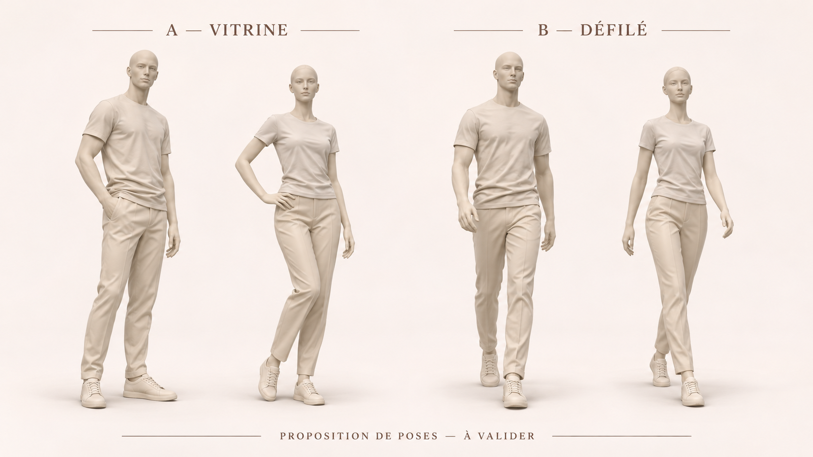

# Où sont les mannequins 3D ?

Demande de Rhamone, 14 novembre : « Tu dois être clair où sont les 3d sur le git et tout ? »

## Trois livrables distincts

| Livrable | Où | État réel |
|---|---|---|
| Mannequins actuellement utilisés | `public/models/mannequin.glb`, `public/models/mannequin-femme.glb` sur `main` | Modèles du site ; la PR #127 (e1d0909, revue le 14 novembre) les remplace désormais par une adaptation des prototypes ivoire de cette PR. |
| Nouveaux prototypes ivoire | Cette branche, `assets-src/models/prototypes-ivoire/` | Deux vrais maillages statiques, homme et femme, avec exports GLB et fichiers Blender. Pas intégrés au Walk. |
| Personnages habillés look 06 et look 05 | Références photo dans #128 et `assets-src/references/mannequins-3d/` dans #127 | Les photos face/dos sont en 2D. Cette PR ne fournit PAS leur reconstruction 3D. La PR #127 fournit désormais des GLB avec projection des photos sur le corps ivoire : ce ne sont pas des reconstructions fidèles des vêtements. |

Les prototypes ivoire étaient jusqu’ici uniquement dans le workspace `/workspace/shared/direction-personnages/`, pas sur GitHub. Un lien local ne donnait pas accès à ces modèles au Claude d'une autre session. Cette PR corrige la transmission.

## Fichiers à récupérer dans cette branche

- [Homme — Blender](../assets-src/models/prototypes-ivoire/homme-prototype.blend)
- [Homme — GLB](../assets-src/models/prototypes-ivoire/homme-prototype.glb)
- [Femme — Blender](../assets-src/models/prototypes-ivoire/femme-prototype.blend)
- [Femme — GLB](../assets-src/models/prototypes-ivoire/femme-prototype.glb)
- [Contrôle multi-angle des deux GLB](../assets-src/models/prototypes-ivoire/controle-3d.png)

Branche : `feat/gpt/sources-mannequins-3d`. Depuis un checkout du dépôt, après `git fetch origin`, lire/récupérer cette branche ; les fichiers ne sont pas encore sur `main`. Pour un téléchargement GitHub, utiliser « Download raw file » sur chaque fichier binaire, ou cloner la branche.

## Ce qui a réellement été vérifié

- Les deux GLB se chargent avec Three.js et s'importent dans Blender 4.3.2 ; les `.blend` ont été enregistrés après import.
- Homme : 22 743 sommets, 39 208 faces ; hauteur importée environ 1,80 m. Femme : 21 751 sommets, 38 092 faces ; hauteur importée environ 1,75 m.
- Chaque GLB pèse environ 3,3 Mo ; chaque `.blend` environ 6 Mo. Ces tailles ne constituent pas une validation de performance téléphone.
- Chaque modèle contient un seul maillage, zéro squelette de déformation et zéro animation. Les habits ne sont pas des objets interchangeables séparés.
- Les fichiers Blender sont des scènes importées éditables, pas des sources paramétriques avec historique de sculpture ou rig.

## Ce qui reste à faire

- La pose de travail bras légèrement écartés est encore dans ces modèles. La proposition de poses A validée par Rhamone (homme détendu, femme main sur hanche) n’a PAS été appliquée à ces fichiers.
- Vérifier orientation, anatomie des mains, plis, intersections, contact des semelles et largeur dans les vitrines.
- Pour les poser : préparer le squelette et ses poids, corriger les déformations, puis exporter une pose statique si le Walk n'a pas besoin d’animation.
- Pour changer leurs vêtements : séparer/reconstruire corps et habits ; le maillage vêtu monobloc ne suffit pas.
- Optimiser et tester dans une seule vitrine sur un vrai téléphone avant généralisation. Ne pas remplacer les modèles de `public/models/` à l'aveugle.

## Consigne pour Rhamone et Serge

La PR #127 a désormais repris les prototypes ivoire et les a posés dans Blender. Les sources ici restent inchangées ; les adaptations sont dans `assets-src/blender/mannequins-ivoire.py` sur la branche `feat/rhamon/mannequins-duo`. Éviter deux remplacements concurrents des mêmes fichiers.

Pour le look 06 (Stüssy/Acne, Timberland) et le look 05 (Trapstar rose, Air Max), une reconstruction 3D depuis les photos reste un nouveau travail. Utiliser les deux vues comme références, contrôler le profil, et ne pas annoncer un personnage articulé simplement parce qu’un GLB a été produit. Ne pas relancer la création des prototypes ivoire en pensant qu’ils n’existent pas.

Aucun modèle de production, moteur, prix ou donnée admin n’est modifié par cette PR. Les fichiers sont des sources à examiner, pas une validation visuelle finale ni une autorisation de merge.

## Référence de pose validée et revue du 14 novembre

La paire **A — Vitrine** est la cible validée dans la conversation : homme en appui détendu, une main vers la poche ; femme main sur la hanche, genou relâché. Le libellé « à valider » imprimé sur la planche précède cette validation. Cette image est une référence 2D, pas la preuve que la pose existe dans les GLB sources. La paire B reste une variante illustrée.

Revue de #127 au commit e1d0909 : code et captures multi-angle de la branche examinés, pas de validation sur téléphone réel.

- Les visages et mains des modèles ivoire sont plus détaillés. Corriger les démarcations irrégulières au col et aux manches ; chez la femme, la jonction taille/flanc présente encore des éclats blancs. Vérifier face, dos, profils et trois-quarts avant nouveau rendu.
- Les looks habillés 05/06 montrent sur la capture des visages étirés de profil et des mains photographiées superposées aux mains du maillage. Le jean large du 06 et le pantalon évasé du 05 ne sont pas reproduits par le volume. Ne pas présenter ces versions comme des personnages finis. Reconstruire les volumes et UV adaptés, ou garder les mannequins ivoire pendant cette reprise.
- Fournir la scène Blender de la version finale posée et ses textures, en plus des scripts et GLB. Les `.blend` de cette PR sont les bases non posées.
- Critère : silhouette fidèle à la référence, aucun visage dupliqué/étiré en profil, aucune main peinte parasite, semelles sur socle et coudes sans collision avec la vitrine. Prévisualisation ordinateur et téléphone avant validation finale.

Vérification de cette mise à jour documentaire : lint, CSS, types et tests passent ; `npm run check` échoue au build Next avec « Could not parse output from TypeScript's --showConfig ». `tsc --showConfig` produit pourtant un JSON valide ; un second build reproduit l'échec. Aucun code applicatif modifié. Ce contrôle n'est donc pas annoncé vert.
