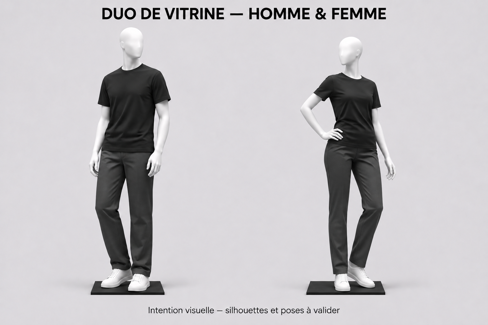
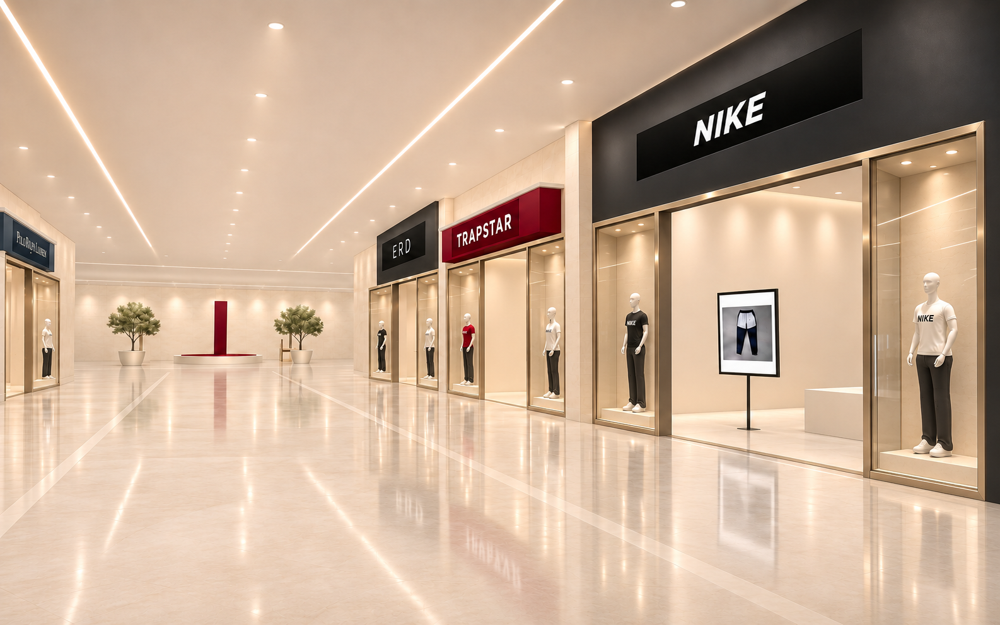

# Walk — finitions luxe et vitrines intégrées

> Direction validée par Rhamone le 8 novembre 2026 : « on garde l'architecture actu », « un sol tres moderne, bcp de luxe dans l'ensemble », « les vitrines au même niveau que la grande porte d'entrée de la boutique ». Go : « voila lets go ».
> Plan de réalisation, pas une modification du site. Première livraison : une zone témoin modélisée dans Blender et vérifiée dans le navigateur. Validation visuelle avant généralisation et merge de la réalisation.

## Reprise après la première réalisation — 8 novembre 2026

### Mannequins : duo et pose féminine validés

Rhamone a demandé d'examiner les modèles actuels avant de proposer, puis a validé la direction retravaillée, le mélange homme/femme et enfin la pose féminine ci-dessous : **« oui je valide »**. Cette référence complète le lot 2 et autorise la reprise des modèles existants dans Blender ; les consignes plus anciennes de simple réutilisation ne doivent pas empêcher ces améliorations. Architecture et dimensions des vitrines restent conservées.

- **Référence finale** : cette image remplace les propositions de poses précédentes. Homme en appui naturel, bras détendus ; femme avec main droite sur la hanche, léger déhanché et genou gauche relâché. Deux silhouettes distinctes, résine blanche mate, tête abstraite sobre, personnages entiers. Pose statique ; aucune animation de marche ou rotation automatique demandée.
- **Ce qui existe déjà** : `assets-src/models/fraul_mannequin.glb`, sorties `public/models/mannequin.glb` et `mannequin-femme.glb`, préparation dans `scripts/prep-mannequin.mjs`. La variante féminine actuelle vient de la déformation du même modèle via `scripts/mannequin-femme.mjs`. Les deux GLB ont été examinés de face, trois quarts et profil sous lumière neutre ; le blanc et les bras fléchis existaient déjà. Ne pas présenter ces éléments comme nouveaux.
- **Reprise précise** : t-shirt avec vraie aisance et tombé naturel, épaules moins anguleuses, col/manches/ourlet propres ; supprimer l'effet de bande irrégulière à la jonction pantalon ; améliorer mains et chaussures, puis ajuster les poses. Sur la femme, adapter les vêtements à sa silhouette sans simplement comprimer le modèle masculin. Vérifier aussi dos et profil pour la future exploration à 360°.
- **Limite du visuel** : illustration de direction, pas rendu d'un GLB déjà réalisé. Tee noir, pantalon anthracite et chaussures blanches neutres servent à valider forme, matière et pose ; ce ne sont pas des références catalogue ni des Nike/Jordan validées. Préserver les couleurs et inscriptions de marques pilotées par le site. Ne pas prétendre que les mannequins portent les vrais articles sans travail et correspondance produit vérifiés.
- **Blender et export** : repartir du modèle source, conserver corps/vêtements/chaussures distincts et sauvegarder une source éditable avec script reproductible. Préparer les deux poses dans Blender, puis exporter des modèles statiques allégés ; adapter le pipeline existant pour qu'une ancienne déformation féminine ou retouche du tee ne déforme pas une seconde fois le nouveau modèle. Préserver les noms de matières attendus par le moteur ou fournir leur correspondance. Comparer le rendu avant/après simplification.
- **Intégration témoin** : un homme et une femme dans les vitrines latérales, en vérifiant l'activation effective de la variante féminine dans `engine.js`. Mesurer la largeur du coude posé sur la hanche et la boîte englobante complète : aucun membre ne traverse verre ou cadre de la baie utile de 1,45 m. Pieds posés, pas de double socle entre la plaque du GLB et le socle de vitrine ; préserver les proportions plutôt que réduire arbitrairement le personnage.
- **Livraison attendue** : comparaison des deux modèles de face/profil/trois quarts, puis duo dans la boutique ERD, captures téléphone/PC et preview réelle avant généralisation. Donner poids et nombre de triangles de chaque export, mesurer l'effet sur la fluidité. La validation de cette illustration autorise la réalisation ; elle ne vaut pas validation automatique du rendu navigateur ou merge.

### Brief consolidé : ensemble du mall et boutique à 360°

Rhamone demande de transmettre **toutes les consignes ensemble**, avec une nouvelle expérience intérieure : « une experience en 360 qui te fais tourner la tete dans une boutique », « aller ou tu veux avec les doigts ou la souris et cliquer pour les articles sans forcement cliquer sur le bouton rayons ».

**Ensemble à prendre en compte dès la préparation** : conserver le sol apprécié ; finir la vitrine ERD (verre, champagne, éclairage, socles) ; présenter Finds avec TUC entier et panneau discret ; affiner plantes et raccords ; harmoniser les trois architectures, entrée et caisse ; préparer la visite libre décrite ci-dessous. Une transmission complète, mais des réalisations et validations séparées. L'intérieur interactif mérite sa propre PR, sans mélanger les contrôles caméra avec les finitions de façade.

**Existant vérifié sur `main` à `551fa3b`** : l'intérieur est déjà une scène 3D. `src/walk/engine.js` propose une arrivée au centre puis des déplacements vers les zones de rayons ; les gestes et la sélection par raycasting portent sur le rayon actif (`if (!active) return`). `src/walk/models/store-layout.ts` contient `RACKS`, `ZONES`, `ISLAND` et `route()` pour contourner l'îlot. Ce n'est pas encore une exploration libre à 360°. Réutiliser la scène, les produits et le parcours existants ; ne pas remplacer la boutique par une photo panoramique.

**Interaction recommandée à montrer en prototype, puis à faire valider :**

| Geste | Résultat attendu |
|---|---|
| Glisser un doigt ou maintenir/glisser la souris sur la scène en exploration | Tourner le regard horizontalement sur 360°, regarder un peu vers le haut/bas sans retournement ni roulis. Aucun gyroscope ou verrouillage de souris obligatoire. |
| Toucher / cliquer un point libre du sol | Se déplacer vers ce point dans l'espace praticable, pas seulement vers les arrêts de rayons. Petit repère de destination ; obstacle contourné, murs et meubles jamais traversés. |
| Toucher / cliquer un article visible, sans ouvrir « Rayons » | Sélectionner son véritable identifiant et ouvrir sa fiche existante ; si une approche est nécessaire, elle est courte et automatique. Aucun passage imposé par le menu des catégories. |
| Fermer la fiche | Retrouver la position et l'orientation d'exploration précédentes. |
| Utiliser « Rayons » | Garder ce raccourci facultatif et accessible pour aller vite ; il n'est plus obligatoire. |

**Conflits de gestes à résoudre explicitement** : séparer exploration, consultation du portant et fiche. En exploration, glisser tourne la caméra, même si le geste commence sur un article ; un clic bref sélectionne. Dans le portant rapproché, conserver le défilement des vêtements et afficher un retour explicite à l'exploration. Mesurer le déplacement du pointeur sur les deux axes, gérer annulation/multitouch et ne jamais ouvrir une fiche après une rotation. Les boutons et fenêtres capturent leurs propres gestes. Prévoir aussi commandes clavier et raccourcis DOM ; ne pas rendre la boutique utilisable uniquement au pointeur.

**Travail moteur** : isoler les contrôles caméra de `engine.js`, adapter `place()`/`walk()` et le raycasting à tous les articles visibles de la boutique, préserver l'occlusion par murs/meubles (ne pas cliquer à travers). Le `route()` actuel contourne seulement l'îlot : définir une surface praticable avec marges autour des meubles et limites de boutique avant d'autoriser des destinations arbitraires. Pas de caméra qui traverse le stock ou sort du décor. Arrêter les déplacements à la fermeture de la boutique ; conserver retour téléphone, Échap et comportement de réduction des animations.

**Travail Blender** : auditer les faces désormais visibles à 360° (arrière des portants, dessous des étagères, plafond, dos des socles) ; compléter uniquement les surfaces manquantes et leurs matériaux. Garder modules et collisions séparés, cotes du magasin, vrais articles et mobilier actuels. La navigation relève du moteur WebGL, pas de Blender. Ne pas fabriquer une nouvelle collection de vêtements en 3D ; les éventuelles limites des photos planes vues de côté doivent être montrées au prototype.

**Acceptation du prototype intérieur** : depuis l'entrée, faire un tour complet du regard, rejoindre deux points libres hors des arrêts prédéfinis en contournant l'îlot, toucher un article de deux rayons différents sans ouvrir « Rayons », fermer la fiche sans perdre son point de vue, puis sortir normalement. Vérifier téléphone tactile et souris, aucun clic accidentel après glissement, aucun passage à travers les meubles, aucun dos de décor vide. Présenter une courte capture en mouvement et une preview réelle ; mesurer la fluidité sur appareil. La demande valide l'objectif ; les gestes proposés et leur rendu restent à valider dans ce prototype avant généralisation.

### Dernier accord : lot 1 apprécié, go pour la suite

Après la comparaison « AVANT / APRÈS (lot 1) » fournie dans la conversation, Rhamone confirme : « Oui j’aime maintenant suivant », puis « Ok go go go go » pour la suite décrite ci-dessous. **Conserver la direction du sol montrée à droite** ; cette appréciation sur image ne constitue pas une mesure de fluidité ni une validation des reflets en mouvement.

**Prochaine livraison : lot 2, une vitrine témoin ERD**, en reprenant la boutique de cette comparaison pour éviter de changer de référence. Préparer verre aux reflets légers, cadres champagne brossés avec petits biseaux sans épaissir les profils, lumière chaude douce sur les mannequins, socles en pierre et ombres de contact. Conserver dimensions, mannequins entiers, entrée libre et sommet des vitrines aligné sur la porte. Fichiers et raccordements : ligne du lot 2 dans le tableau ci-dessous.

**À montrer avant généralisation** : vues de face et depuis l'allée, avant/après au même cadrage, puis preview téléphone/PC avec déplacement pour vérifier verre et reflets. Les vêtements doivent rester lisibles derrière le verre. Ne pas ajouter de mobilier ni modifier le sol déjà apprécié pour compenser un problème d'éclairage.

**Suite autorisée, séquencée** : Finds (cadrage et panneau à présenter), plantes/raccords, puis déclinaison aux trois architectures et harmonisation entrée/caisse. Réutiliser les assets existants. Chaque nouveau choix visuel passe par une présentation et une validation avant réalisation ; chaque réalisation passe par une preview avant généralisation ou merge. Le go ne demande pas de produire tous les lots simultanément. Pour la vie du mall, affiner les changements d'articles, le cycle jour/soir et les portes existants ; aucun nouvel effet décoratif demandé.

Demande de Rhamone : « compare le sol », « mets a jour les remarques et tout pour claude », puis « prepare le reste de la modelisation ». **Préparer la suite et ses visuels ; les nouveaux détails de Finds restent à valider avant réalisation.**

**Déjà livré dans #111**, mergée sur `main` (`551fa3b`) : vitrines intégrées des trois façades, mannequins reculés dans les niches, textures marbre/pierre/champagne issues de `assets-src/blender/textures-mall.py`, olivier issu de `assets-src/blender/plante-mall.py`, ombres douces sous les socles. Réutiliser ces travaux. Les premiers commentaires indiquant l'absence de travail Blender sont dépassés par la version finale de #111.

Contrôle du site public : textures et plante chargées, entrée/sortie de boutique fonctionnelles, pas d'erreur JavaScript relevée ; vues PC 1440 × 900 et téléphone simulé 390 × 844, à 14 h et 19 h. Ce contrôle ne mesure pas la fluidité sur un vrai téléphone. [Capture après #111, PC à 14 h](../assets-src/references/mall-realiste/revue-apres-111-sol.png). La capture utilisateur de Finds présente un autre arrêt et peut correspondre à une version antérieure : les arbres en boules y sont un constat sur cette capture, pas la preuve que le nouveau GLB manque partout.

### Sol : écart avec la cible approuvée

| Point | Rendu observé | Cible / correction à vérifier |
|---|---|---|
| Reflets | Bandes blanches fixes ; presque aucun reflet lisible des boutiques ou mannequins. | Reflets doux et cohérents avec les éléments proches et le déplacement de caméra. |
| Matière | Aspect pâle et assez plat, malgré le motif marbré. | Pierre polie avec relief lumineux discret, sans aspect mouillé ni miroir. |
| Veinage | Motif visible et répétition perceptible sur la longueur de l'allée. | Veines plus discrètes, répétition moins reconnaissable, grandes dalles et joints fins. |
| Lumière | Sol et murs éclairés de façon assez uniforme. | Gradations douces, vitrines légèrement plus lumineuses, ombres de contact qui ancrent les objets. |

**Ordre technique : couleur → lumière → reflets → texture.** Dans `engine.js`, `mallTex()` charge les JPEG sans définir leur encodage ; vérifier aussi `facadeTex`. Avec Three.js 0.128, déclarer les cartes de couleur en `sRGBEncoding` si elles sont bien exportées en sRGB ; laisser les cartes de données (normal, rugosité, AO) linéaires. C'est une cause possible du rendu délavé, pas un diagnostic suffisant à elle seule. Éviter une double conversion.

Les plans `sheenM` sont des dégradés blancs fixes, pas des reflets de la scène. Baisser seulement la rugosité ou ajouter des veines ne résoudra pas ce point. Tester d'abord un environnement filtré partagé pour les matériaux ; il donne une réponse lumineuse, mais ne reflète pas automatiquement les boutiques proches. Si nécessaire, prototyper **un seul reflet planaire limité à la zone témoin**, résolution réduite et coût mesuré. Ne pas le multiplier par boutique. Montrer le compromis sur téléphone avant de choisir la technique finale. Les plafonniers en `MeshBasicMaterial` paraissent lumineux sans éclairer les objets voisins : traiter séparément l'éclairage réel.

### Finds : cadrage et finitions à présenter

Sur la capture de Rhamone, le haut du TUC est coupé, le panneau « Finds · Sur demande » masque la sculpture et le comptoir occupe presque tout le champ. **Proposition à visualiser** : reculer légèrement le point de vue et intégrer une inscription plus discrète sur le comptoir. Garder le TUC, le comptoir courbe ivoire/bordeaux, leur implantation et l'accès au formulaire. Ne pas supprimer ni réécrire les textes sans validation.

Repères pour reprendre exactement l'existant : `src/walk/views/concierge.ts` (comptoir, panneau), `initMall()` dans `src/walk/engine.js` (TUC et plantes), `src/walk/modes/t.ts` et `src/walk/models/mall-layout.ts` (arrêt et implantation). Comptoir : rayon 1,60 m, hauteur 1 m, plateau à 1,01 m ; panneau actuel 2,20 × 0,69 m, centre à Y = 2,05 m. Importer ces proportions avant toute retouche. Vérifier le cadrage sans changer le parcours global.

## Suite de modélisation — lots courts, dans cet ordre

| Lot | Travail Blender / préparation | Raccordement et réussite visible |
|---|---|---|
| 1. Sol et lumière témoins | Reprendre le script de textures existant ; préparer un morceau d'allée aux cotes actuelles, veinage discret, joints fins et UV à échelle réelle. Réutiliser une façade et les GLB pour juger les reflets. | `engine.js`, `src/walk/models/daylight.ts` : couleur correcte, ombres de contact, reflets doux. Comparaison jour/soir au même angle ; validation de ce lot avant extension. |
| 2. Finitions d'une vitrine | Reprendre la niche déjà livrée : cadres séparés, petits biseaux, pierre, métal champagne, verre et socle. Mesurer les GLB avant d'ajuster la profondeur ; ne pas recréer les mannequins. | `src/walk/views/facades.ts`, `buildDetail()` : personnage entier, pieds posés, verre perceptible et transparent, haut aligné sur l'entrée, passage libre. Une vue de face et une vue depuis l'allée. |
| 3. Centre Finds | Préparer une scène avec le TUC et le comptoir aux dimensions actuelles. Présenter le cadrage corrigé et la proposition de panneau discret ; après validation, biseaux et matières satinées sur les volumes conservés. | `concierge.ts`, `engine.js`, mode T : TUC lisible, comptoir moins envahissant, bouton et clic sur le comptoir toujours fonctionnels. Validation du visuel avant export de remplacement. |
| 4. Plantes et raccords | Inspecter l'olivier déjà livré avant de le retoucher. Si nécessaire, affiner feuillage, tronc, bord du pot et contact au sol ; réutiliser le même asset avec variations de rotation. | `plante-mall.py`, `public/models/plante.glb` : pas de grandes masses polygonales dominantes au premier plan ; silhouette crédible sans surcharge de transparence. Conserver les positions et le secours en cas d'échec de chargement. |
| 5. Déclinaison et continuité | Après validation, appliquer les finitions aux trois styles et aux raccords mur/sol/plafond. Réutiliser les portes d'entrée et la caisse existantes, harmoniser leurs matières seulement si nécessaire. | `facades.ts`, `entrance.ts`, `caisse.ts` : architecture et colonnes intactes, aucune rupture de matière, portes et caisse fonctionnelles. Pas de nouveau mall monolithique. |

**Dossier de travail Blender proposé** : `assets-src/blender/mall-finitions.blend` et `assets-src/blender/mall-finitions.py` (à créer dans la PR de réalisation, pas présents dans ce plan). Collections séparées `Gabarit`, `Sol`, `Facade`, `Vitrines`, `Finds`, `Vegetation`, `Lumieres`. Le script doit mettre à jour les objets par nom, sauvegarder et exporter seulement le lot travaillé, sans reconstruire chaque fois toute la scène via MCP. Garder les scripts et assets de #111 comme point de départ.

**Livraison par lot** : source éditable + script reproductible, textures/GLB seulement si nécessaires au moteur, liste des fichiers remplacés, captures avant/après au même cadrage et lien de preview. Les noms de marques, produits et mannequins restent pilotés par le site, hors texture de décor. Un rendu Cycles seul ne valide pas le résultat WebGL ; vérifier l'export dans le navigateur avant de détailler les zones suivantes.

**Prochain retour attendu après l'accord sur le comparatif du lot 1** : une comparaison visuelle de la vitrine ERD pour le lot 2 ; la proposition de cadrage Finds vient ensuite. Ne pas lancer tous les lots à la fois. Conserver la caisse et les mannequins existants ; aucune nouvelle tenue 3D, animation de foule ou refonte du portant dans ce chantier.

## Lire et démarrer

1. Regarder la référence ci-dessous et les mesures (§ Dimensions).
2. Lire les règles du dépôt, puis seulement les parties concernées de `facades.ts`, `mall-layout.ts`, `initMall()` / `buildDetail()` dans `engine.js` et `daylight.ts`.
3. Repartir de `origin/main` à jour et vérifier les PR ouvertes. #107, #108, #110 et #111 sont maintenant mergées ; préserver leurs changements. #109 reste le dossier de plan, pas une branche d'implémentation à reprendre telle quelle.
4. Reprendre une boutique témoin du type « enseigne », avec son morceau d'allée et les vitrines de #111. Fournir une vue de face et une vue depuis l'allée avant d'étendre les nouvelles finitions aux deux autres types.

## Références et limites

- **Cette image valide** : sol ivoire poli à grands formats et joints fins, reflets doux, pierre claire, métal champagne brossé, couleurs des boutiques conservées, éclairage chaud des vitrines, mannequins derrière le verre. Vitrines latérales intégrées au plan de la façade ; leur haut s'aligne sur le haut de l'entrée. Entrée centrale dégagée.
- **Elle ne remplace pas les cotes ni les trois architectures** : les colonnes du portique Trapstar ont été simplifiées dans l'image ; garder les colonnes, leurs bases, chapiteaux et frontons du code. Ne pas recopier cette simplification.
- Les vêtements et inscriptions de la maquette ne valident aucun nouvel article ou logo. Réutiliser modèles de mannequins et données de marques du site ; les photos produits restent celles du catalogue.
- [Capture de départ](../assets-src/references/mall-realiste/existant-facade.png) : version locale `b0ef763`, `/walk?heure=14`, viewport 1440 × 900, premier arrêt. Les fichiers `facades.ts` et `mall-layout.ts` sont inchangés dans la base de ce plan `05754ea`. Cette capture n'est pas une capture de la production actuelle.
- Les anciennes propositions avec boutique entièrement redessinée ou vitrines étroites en saillie sont écartées. La cible ci-dessus est l'unique référence d'ambiance à utiliser.

## Existant et périmètre

| État | À respecter |
|---|---|
| Déjà construit | Mall paramétrique, trois façades, cycle jour/soir, vitrines avec photos changeantes, mannequins et caisse GLB. |
| Amélioration validée | Matières, reflets, ombres et vitrines latérales vitrées alignées sur l'entrée, sans changer le parcours ni les volumes généraux. |
| Décision antérieure maintenue | Décors Blender de remplacement refusés le 28 octobre : aucun nouveau mall monolithique, aucune refonte du plan. Blender sert ici aux finitions et modules conformes à l'architecture existante. |
| Hors de ce lot | Accueil, défilé de looks, portant, création de tenues, catalogue, paiement, navigation. Aucun passant animé ni musique automatique. |

## Dimensions et raccordement

Source : `src/walk/models/mall-layout.ts` et `src/walk/views/facades.ts`, base `05754ea`. Les unités de scène sont traitées comme des mètres. Relire les valeurs si ces fichiers évoluent.

| Repère | Mesure existante / contrainte |
|---|---|
| Emplacement d'une boutique (`SLOT`) | 8,50 m ; façade d'environ 8,30 m, conserver les raccords entre boutiques. |
| Hauteur du mall (`CEIL`) | 6,40 m. |
| Ouverture centrale | 4,80 m de large × 4,20 m de haut. Conserver le passage. |
| Axes des baies latérales | X = −3,25 m et +3,25 m dans le repère local de la boutique. |
| Largeur nominale de chaque baie | 1,75 m ; largeur vitrée utile à ajuster aux cadres et colonnes existants. |
| Alignement supérieur | Y = 4,20 m pour les deux vitrines et le cadre de l'entrée. |
| Plan de façade | Cadre de porte actuellement centré à Z = +0,42 m, épaisseur 0,08 m. Aligner la face extérieure des nouveaux cadres sur celle du cadre de porte ; verre légèrement en retrait. |
| Sens de profondeur | Z positif vers l'allée, Z négatif vers la boutique ; vitrine creusée vers l'intérieur. Aucun caisson avancé dans l'allée. |
| Colonnes du portique | Axes X = ±2,62 m, Z = +0,72 m ; rayon 0,17 m, bases/chapiteaux 0,50 m. Les conserver, adapter la baie autour. |

Élévation de principe : **vitrine gauche — entrée libre — vitrine droite**, sommet commun à 4,20 m. Le socle du mannequin reste bas ; sa hauteur et la profondeur de niche sont des réglages techniques à vérifier avec les dimensions réelles du GLB, pas des cotes validées dans l'image.

Dans `engine.js`, `buildDetail()` plaçait initialement les mannequins à X = ±3,25, Z = +0,90. **#111 les a déjà reculés à Y = 0,14, Z = −0,05 dans les niches**, dont l'ouverture utile est de 1,45 m et le sommet à 4,20 m. Conserver ce travail et vérifier la boîte englobante de chaque mannequin : mains et chaussures derrière la vitre, pieds sur le socle, échelle inchangée.

L'origine du module reste au sol, au centre de la façade. Blender : mètres, Z vertical ; export glTF vers Y vertical. Vérifier les axes après réimport pour éviter une double rotation. L'emplacement et l'orientation globaux restent calculés par `SLOTS` et `shopType(k)`.

## Matières et lumière

| Élément | Cible visible | Point de départ technique, à régler sur la preview |
|---|---|---|
| Sol | Grandes dalles ivoire polies, veinage presque imperceptible, joints fins, reflet doux des vitrines. | Texture répétable, relief discret ; métal = 0, rugosité environ 0,20–0,30. Éviter sol jaune, mouillé ou miroir. |
| Murs | Pierre claire avec grain fin et angles propres. | Métal = 0, rugosité environ 0,55–0,75 ; petits biseaux sur les arêtes visibles. |
| Encadrements | Champagne brossé, profils fins. | Matière métallique, rugosité environ 0,25–0,40 ; préserver les largeurs d'ouverture. |
| Verre | Transparent, contours et reflets légers, tenue lisible. | Tester la méthode compatible avec le moteur actuel avant de multiplier les vitres ; vérifier tri de transparence et visibilité des objets derrière. |
| Bordeaux / marques | Bordeaux satiné, couleurs propres aux enseignes conservées. | Garder la couleur dynamique de chaque marque ; ne pas figer noms et logos dans une texture commune. |
| Éclairage | Allée claire, spots doux sur les mannequins, ombres sous socles et dans les angles. | Garder les lignes de plafond existantes et `daylightAt()`. Ajuster lumière et exposition avant de multiplier les sources. |

La version actuelle utilise Three.js 0.128 : vérifier les matériaux/extensions réellement pris en charge par son chargeur GLB. Un matériau Blender complexe ou un éclairage Cycles ne se transfère pas automatiquement. Les surfaces statiques peuvent recevoir des textures de matière et d'occlusion précalculées ; éviter de cuire une lumière de plein jour qui annulerait le cycle soir/nuit.

## Méthode Blender pour chaque lot

1. **Gabarit et vitrines.** Reprendre les cotes du code et les niches de #111, réutiliser les mannequins GLB, compléter uniquement les finitions nécessaires. Garder objets, matières et origine clairement nommés (`Facade`, `Vitrine_G`, `Vitrine_D`, `Verre_G`, `Verre_D`, `Socle_G`, `Socle_D`, `Repere_Enseigne`). Regrouper les opérations MCP dans un script reproductible, sans recréer toute la scène à chaque ajustement. Montrer vue de face et vue depuis l'allée.
2. **Matières et lumière.** Appliquer le tableau ci-dessus, préparer UV et textures exportables. Réutiliser caisse et mannequins ; ne pas modéliser une nouvelle collection de vêtements. Produire un rendu au cadrage de référence, puis un GLB de la zone témoin. Garder enseigne, mannequins et produits indépendants du décor pour éviter les doublons et garder les données dynamiques.
3. **Vérification navigateur.** Intégrer seulement la zone témoin sur une branche de réalisation depuis `main` à jour. Comparer même angle, même heure et même viewport, puis téléphone. Ajuster les reflets selon le coût mesuré. Après validation de Rhamone, appliquer les finitions aux trois styles en gardant leurs différences et la génération paramétrique du mall.

Livrables de réalisation : `.blend` éditable et script dans `assets-src/`, GLB et textures optimisés dans `public/`, captures avant/après, lien réel de preview. Cette PR de plan contient seulement la note et les références ; #111 fournit déjà les scripts de textures/plante et leurs assets. Aucun `.blend` de zone témoin n'a été trouvé dans le dépôt contrôlé. Compléter l'existant selon les lots ci-dessus. Auteur des commits : Kelthen, sans signature supplémentaire.

## Réussite et contrôles

- Au téléphone, chaque mannequin apparaît **entier derrière le verre**, de part et d'autre de la grande entrée ; vitres au même niveau et même hauteur que l'entrée, socles ancrés au sol, aucun élément en travers du passage.
- Les trois types « enseigne / verrière / portique » restent reconnaissables ; colonnes du portique conservées. La marque provient des données, pas du numéro d'une boutique.
- Matériaux et lumière évoquent la cible ; aucune prétention d'identité pixel par pixel entre image, Blender et navigateur. Présenter tout écart visible avant de généraliser.
- Conserver les vitrines changeantes et le jour/soir existants pour donner de la vie. Aucun nouveau mouvement décoratif ajouté à ce lot.
- Réutiliser géométries/textures et charger les détails proches de la caméra comme aujourd'hui. Mesurer poids téléchargé, nombre d'appels de rendu et fluidité avant/après sur le même appareil ; éviter un reflet planaire et une ombre dynamique par boutique. Viser au moins 30 images/s sur le téléphone de test, à mesurer, sans le présenter comme garanti.
- Tester jour (`?heure=14`) et soir (`?heure=19`), téléphone et PC ; pas de mannequins cachés, surfaces qui clignotent ou verre opaque. Le verre ne change pas la cible tactile : toucher une vitrine ouvre toujours sa boutique ; entrée/sortie et retour téléphone conservés (L-44, L-45, L-49).
- Avant la PR de réalisation : `npm run check`, puis contrôles Walk téléphone/PC avec `npm run smoke`. Inclure les résultats et les limites matérielles du test. Rhamone valide la preview avant merge.

La PR de plan reste en brouillon et sera fermée quand le travail sera livré, conformément à la décision du 8 novembre ; les décisions et références utiles doivent être reprises dans la PR de réalisation.
