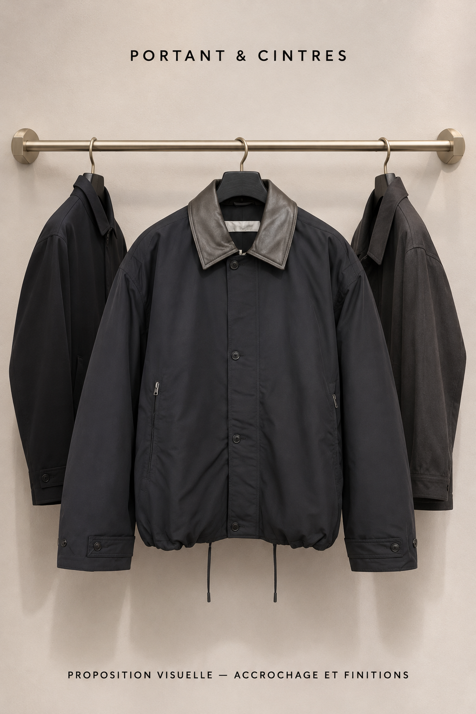
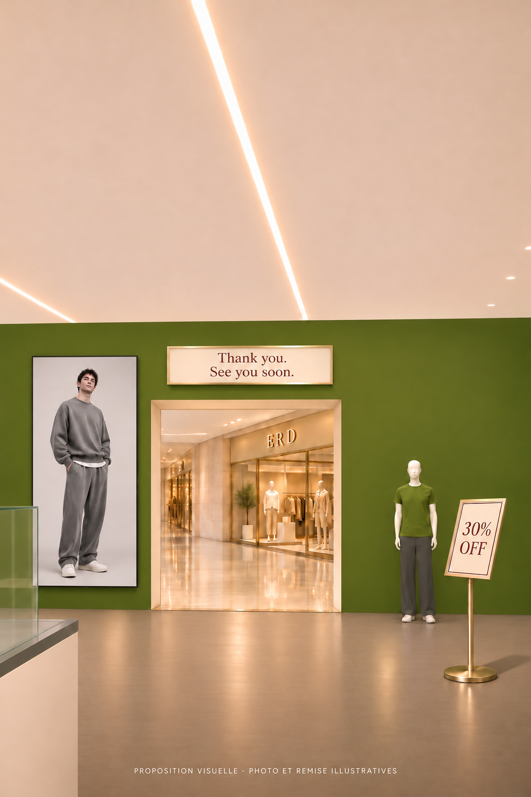

# Walk : rendre le produit sélectionné lisible et désirable

**Responsable de réalisation : côté Serge pour le code, les photos et les réglages de présentation.** Rhamone réalise les assets Blender et valide les previews. Voir [la répartition complète](REPARTITION-WALK-SERGE-RHAMONE.md), qui inclut les tâches pouvant commencer sans attendre les modèles.

Demande de Rhamone, 9 novembre : accessoires trop hauts, sneakers trop petites, bijoux confondus avec les rayons derrière, mannequin blanc envahissant, photo de montre à conserver complète ; « Il faut bien lui détailler et photos ». Accord « Exactement » sur la présentation adaptée à chaque photo et le mannequin hors cadrage de consultation. Dossier de préparation pour #114, sans modification du site. Les valeurs ci-dessous sont des points de départ à vérifier sur preview, pas des mesures déjà validées.

## Images et provenance

Les captures utilisateur ont été examinées dans la conversation. **Leurs fichiers ne sont pas disponibles dans ce checkout** : les chemins `C:/Users/hp/OneDrive/Images/Captures d’écran/…` appartiennent au PC de Rhamone. Ne pas prétendre que les captures sont jointes ici. Les deux dernières sont `Capture d'écran 2026-11-09 105819.png` (fiche G-Shock complète) et `Capture d'écran 2026-11-09 105838.png` (même photo petite dans le Walk, mannequin blanc à droite). Les joindre à cette note dès réception des PNG ; les autres captures montrent ceinture Balenciaga, chaîne/bracelet, sneakers Lanvin, portefeuille Corteiz, cintres et écran des looks.

Références visuelles déjà disponibles, avec périmètre précis :

Cette illustration valide crochet court en contact avec le tube, cintre et fixations. Elle ne remplace pas la vraie photo produit et ne change pas l'angle à 45° ni l'animation validée.

Cette illustration valide taille et implantation de l'écran, tableau anglais et circulation. **Nouveau réglage demandé : ajouter un peu de respiration autour de la personne dans l'écran**, sans réduire l'écran mural lui-même. Photo, boutique en face et remise de la maquette restent illustratives.

## 1. Règle commune de sélection

Dans `src/walk/engine.js`, séparer clairement rayon au repos et consultation d'un article. Dans `src/walk/models/store-layout.ts`, les dimensions, `pull`, `rise` et `close` restent actuellement propres à chaque catégorie ; dans la branche inspectée, `watch.rise = 0.5`, `jewelry.rise = 0.9`, et l'atténuation des voisins dépend notamment de `closeAmt`. Ce sont des pistes vérifiées dans le code, pas la preuve d'une cause unique pour toutes les captures.

- Définir la zone réellement libre entre titre, menu et panneau d'achat selon le viewport. Centrer l'article dans cette zone, pas au centre de la page entière ni à une hauteur mondiale fixe commune aux rayons.
- Dès la sélection, viser environ 65–75 % de l'espace disponible dans la dimension limitante, ratio conservé, article entier. Vérifier les bords visibles du produit, pas seulement la taille de son image ou du plan 3D. Ne pas demander « En grand » pour avoir une première lecture satisfaisante.
- Atténuer les autres rayons et dégager le fond immédiatement derrière le produit. Le flou est une option à tester, pas une obligation de post-traitement coûteux. Pas d'objet voisin lisible à travers une chaîne, pas de mannequin devant le produit, pas d'étagère traversant son image.
- Le mannequin garde sa place dans la boutique ; modifier le cadrage ou sa visibilité pendant la consultation, pas supprimer tous les mannequins ni déplacer toute l'architecture.
- Fermer la consultation restitue position/orientation et rayon précédents. Préserver prix, tailles, panier, navigation tactile et souris, et la présentation des lunettes que Rhamone juge satisfaisante.

## 2. Cas à traiter et critères visibles

| Cas observé | Correction demandée | Critère de réussite |
|---|---|---|
| Ceinture Balenciaga | Descendre et centrer la présentation ; choisir une vue où boucle et ceinture sont lisibles. Réduire la place du comptoir dans le cadrage de consultation. | Article entier, boucle identifiable, aucun contact avec titre ou haut de vitrine. |
| Portefeuille Corteiz | Ramener l'article sélectionné dans la zone de consultation ; garder les autres variantes secondaires. | Motif et matière visibles ; aucun portefeuille coupé par le haut de l'écran. |
| Sneakers Lanvin | Agrandir la vraie photo, sélectionner la meilleure vue disponible ; préserver les deux chaussures si la photo montre une paire. | Semelle, lacets et couleurs lisibles sans zoom supplémentaire ; aucune coupe, déformation ou chaussure inventée. |
| Chaîne Vivienne Westwood | Isoler la silhouette entière sur un fond contrasté adapté, puis proposer les vues de détail existantes. | Aucun verre de lunettes derrière le pendentif ; chaîne visible sans maillons effacés par le détourage. |
| Bracelet sombre | Même règle d'isolation, fond plus clair que la pièce. | Contour, fermoir et motifs lisibles ; noir sur noir interdit si les détails disparaissent. |
| G-Shock | Choisir une photo de présentation plus rapprochée si elle existe, garder la composition avec boîte/documents dans la galerie. | Cadran et bracelet lisibles ; original toujours accessible ; mannequin blanc hors du champ principal. |

## 3. Photos : conserver l'original et choisir le bon traitement

Deux modes explicites par article, avec choix contrôlable et réversible :

1. **Photo produit isolé** : détourage uniquement s'il conserve intégralement les contours, trous et détails. Présentation sur fond choisi pour le contraste. Ne pas réappliquer automatiquement un effacement de fond à une photo qui a échoué.
2. **Photo composée** (boîte, documents, décor, plusieurs objets) : conserver la photo entière dans la galerie. Choisir une autre image rapprochée pour le Walk ; à défaut, préparer un recadrage validé autour du produit sans couper cadran/bracelet/chaussure. Ne pas supprimer des morceaux du produit pour faire disparaître le décor. Ne pas inventer une partie cachée.

Pour la G-Shock, la miniature « Détail 1 » paraît plus rapprochée sur la capture, **mais son original doit être ouvert avant de la sélectionner**. La capture de fiche montre que la composition complète est disponible ; elle ne prouve pas à elle seule qu'un détourage a détérioré la montre. Comparer original, dérivé et rendu avant de diagnostiquer.

Préserver source et galerie, et identifier séparément l'image de présentation du Walk si nécessaire. Réutiliser le modèle de données existant ; proposer toute extension de schéma dans une étape distincte avant application. Ne pas modifier les données/prix pendant ce travail de préparation. Examiner `knockOut()`, `opaqueBox()` et le chargement de texture dans `engine.js` ; conserver les précautions CORS pour les photos distantes.

## 4. Fonds des bijoux

- Argent clair : tester anthracite mat ; bijou noir : gris perle ; pièce mixte : gris moyen neutre. Ce sont des propositions à montrer, pas un fond noir obligatoire pour tout le catalogue.
- Le fond de présentation ne recolore pas le produit. Si la photo contient déjà un fond blanc opaque, changer la couleur du composant ne le retire pas : conserver l'original tant qu'un détourage fidèle n'est pas disponible.
- Chaîne : vue entière en premier, détail du pendentif ensuite. Garder les vrais reflets/couleurs ; pas de bijoux reconstruits pour produire une jolie maquette.

## 5. Cintres, écran et zone du mannequin

- **Cintres** : la capture montre encore un espace entre crochets et barre. Corriger l'ancrage du support, pas seulement son dessin. Vérifier repos → sortie de l'article → retour, sans doublon avec un cintre déjà présent dans la photo. Conserver espacement et angle à 45°. Référence de finitions ci-dessus.
- **Écran des looks** : le code inspecté dimensionne l'écran selon la photo, sans marge. Garder le grand écran stable ; afficher la photo en conservant son ratio avec environ 5–8 % de marge à tester autour du personnage. Ne pas étirer ni rogner cheveux/chaussures. Fond assorti à la photo ; vérifier plusieurs ratios lors du changement de look. Réutiliser les vraies photos publiées de la marque.
- **Mannequin près des accessoires** : ne doit plus remplir la droite du cadre pendant la consultation ; le vérifier pour chaque catégorie et aux deux formats, pas uniquement pour la montre.
- **Tableau au-dessus du mannequin** : idée supplémentaire de Rhamone, encore à visualiser. Recommandation : rectangle horizontal fin, campagne de la marque, ou promotion réelle si disponible. Ne pas ajouter maintenant un cadre décoratif arbitraire ni une remise fictive. Cette idée n'est pas une validation de disposition.

## 6. Livraison attendue, avant généralisation

1. Comparaisons avec les vraies photos : G-Shock (composition + vue rapprochée retenue), sneaker, bijou clair, bijou sombre. Présenter le traitement proposé avant de l'appliquer à toutes les catégories.
2. Preview réelle PC et téléphone : article entier, grand, centré dans l'espace utile ; pas de recouvrement du titre/achat ni de concurrence du mannequin ou des autres rayons. Tester ceinture et portefeuille en plus des quatre témoins.
3. Séquence courte : sélection, changement d'article, ouverture galerie complète, fermeture et retour au même point de vue ; gestes de rotation sans clic accidentel. Vérifier les lunettes sans régression.
4. Cintres au repos/en mouvement et écran avec marges sur plusieurs looks. Fournir captures avant/après au même viewport et mesures de fluidité sur le même appareil ; `npm run check` et contrôles Walk requis dans la réalisation.

**Statut** : principe de sélection et adaptation des photos validé ; fonds, proportions finales et tableau supplémentaire à confirmer visuellement. Aucun code de réalisation ni merge autorisé par ce dossier seul sans suivre la boucle de validation convenue.
