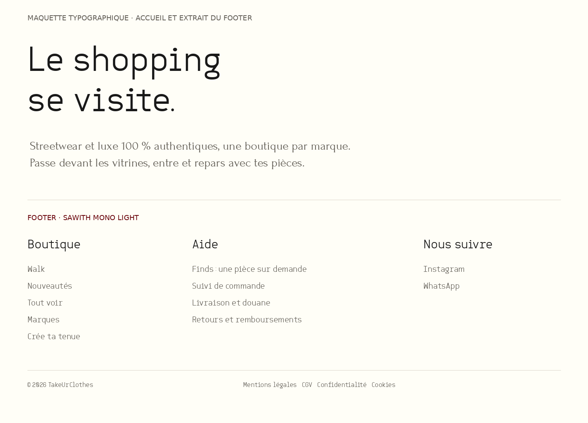

# Typographie accueil et footer — choix validé

Rhamone valide (« Je valide ») la maquette ci-dessous : **Sawith Mono Light pour « Le shopping se visite. » et le footer ; Forum Regular pour le petit texte sous le titre**. Réalisation côté Serge, conformément à la répartition code/Blender. Aucun fichier de police Sawith n'est distribué dans cette PR de préparation.

## Application précise

| Zone | Police et traitement validés | Où intervenir |
|---|---|---|
| Titre d'accueil | Sawith Mono **Light**, sans gras ni italique synthétique ; deux lignes « Le shopping » / « se visite. », teinte sombre de la maquette. | `src/app/layout.tsx`, `src/app/page.tsx`, `.mall-copy h1` et son `em` dans `src/app/globals.css`. |
| Petit texte sous le titre | **Forum Regular** ; conserver le texte existant mot pour mot, des lignes aérées et un contraste lisible. | `.mall-copy p.lead` ; variable de police dédiée, pas un remplacement global de la police de corps. |
| Footer | **Sawith Mono Light** pour les titres de colonnes, liens et mentions ; casse naturelle « Boutique », « Aide », « Nous suivre », sans gras ni espacement exagéré. | `src/components/SiteFooter.tsx`, `.foot`, `.foot h3` et règles associées. Préserver la police du logo. |

Existant vérifié sur `main` à `d527983` : Martian Mono sert actuellement au titre, Monomakh aux aides photo ; le footer utilise des titres petits, gras et en majuscules. Remplacer ces traitements uniquement dans le périmètre validé. **Monomakh reste pour « Touche pour agrandir »** : aucune demande de la retirer de ces aides. Bodoni Moda, Montserrat et la typographie des autres pages ne changent pas.

La maquette est un extrait de composition pour juger les polices, pas une capture du site. Ses mentions « MAQUETTE… » / « FOOTER… » ne doivent pas apparaître en production. Conserver logo, navigation, URLs, icônes sociales, grille responsive et contenus du footer existants ; les noms Instagram/WhatsApp en texte dans l'extrait ne demandent pas de remplacer les icônes. Ne pas reprendre ses grandes dimensions comme tailles fixes sur téléphone.

## Fichiers et licences

- Rhamone a fourni `sawith-mono.zip` contenant Light, Regular, Medium, SemiBold et Bold en TTF. La maquette utilise réellement **SawithMono-Light.ttf** et **Forum-Regular.ttf**.
- La licence jointe Sawith, « 1001Fonts Free For Personal Use License », réserve la gratuité à l'usage personnel ; utilisation commerciale et publication du fichier soumises à l'autorisation de l'auteur. Le ZIP reçu ne prouve pas une licence commerciale. **Ne pas committer, publier ou déployer le fichier Sawith avant confirmation d'un droit d'utilisation web commercial et du mode de distribution autorisé.** La validation visuelle ne vaut pas achat ni permission commerciale.
- Forum est disponible sous [SIL OFL 1.1](https://github.com/google/fonts/blob/main/ofl/forum/OFL.txt), compatible avec l'usage commercial. Conserver la licence si la police est embarquée localement. [Monomakh](https://github.com/google/fonts/blob/main/ofl/monomakh/OFL.txt) est également sous OFL : elle n'est pas écartée pour une raison de coût ; Forum est le choix esthétique validé pour le sous-titre.
- Une fois les droits Sawith confirmés, utiliser le fichier autorisé via `next/font/local` selon la documentation Next du dépôt ; déclarer son poids réel, éviter faux gras et fausse italique. Avant cela, conserver le fallback existant pour le titre et ne pas présenter Martian Mono comme le rendu Sawith final. L'intégration de Forum peut avancer séparément.

## Réception attendue

1. Montrer titre et texte ensemble, puis footer, sur téléphone (390 px) et PC. Comparer à la maquette : Light, aucun gras/italique involontaire, titres de footer en casse naturelle.
2. Vérifier accentuation, retours de ligne, absence de débordement, taille des liens tactiles et contraste des petits textes. Ajuster taille/interligne responsive, sans changer la famille ou épaissir arbitrairement la police.
3. Contrôler le chargement effectif de la police, le fallback et les décalages de mise en page. Fournir `npm run check` et preview réelle avant validation et merge. Aucun autre chantier du Walk dans cette PR de réalisation.
